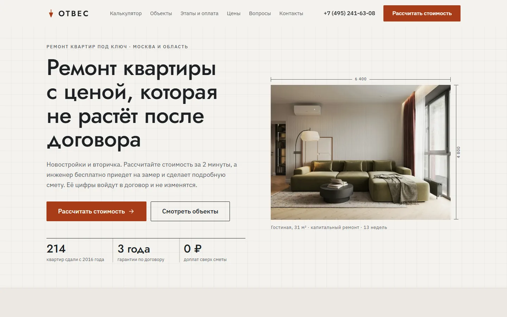
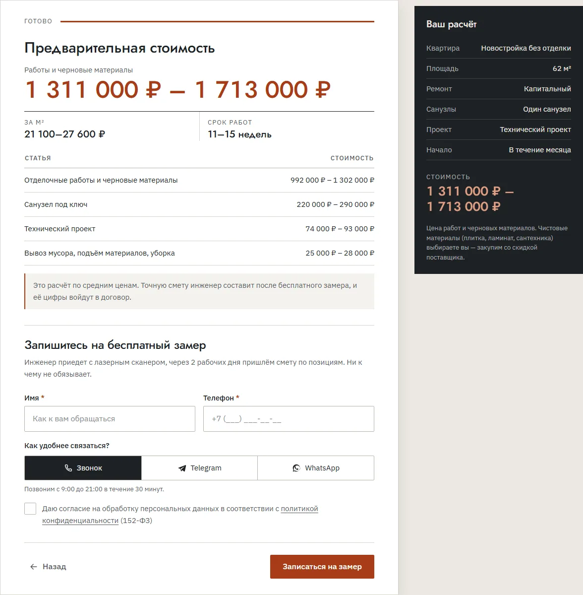

# «Отвес» — ремонт квартир под ключ, демо-сайт

**Будущий адрес:** https://p4yla.github.io/otves-remont/

Одностраничный сайт вымышленной компании по ремонту квартир в Москве и области. Главная задача сайта — посетитель проходит квиз-калькулятор, видит вилку стоимости и записывается на бесплатный замер. Такой сайт рассчитан на трафик из Яндекс Директа.

**Демо-проект для портфолио. Компания, телефон, адрес, объекты, цены и отзывы вымышлены.**
Разработка: Анисимов П.Э., Telegram [@p4yLa](https://t.me/p4yLa).

| Компьютер | Телефон |
|---|---|
|  |  |



## Что умеет сайт

- **Калькулятор за 2 минуты.** 7 вопросов: тип жилья, площадь, вид ремонта, санузлы, демонтаж, дизайн-проект, сроки. В конце — вилка цены, цена за м², срок в неделях и разбивка по статьям. Цена пересчитывается прямо во время ответов.
- **Калькулятор «понимает» ремонт.** Для новостройки без отделки нельзя выбрать косметический ремонт, а вопрос про демонтаж пропускается.
- **Заявка с готовой сметой.** Клиент оставляет имя, телефон и удобный способ связи (звонок, Telegram, WhatsApp). Менеджер получает в Telegram все ответы и рассчитанную смету — может звонить уже подготовленным.
- **Ответы не теряются.** Если посетитель случайно обновил страницу, калькулятор откроется на том же шаге.
- **Объекты «до/после».** Шторку можно тянуть мышью, пальцем или стрелками на клавиатуре. У каждого объекта площадь, срок и итоговая цена.
- **Доверие.** Этапы с поэтапной оплатой, пример сметы по позициям, гарантии из договора, фотоотчёт в чате, отзывы и ответы на частые вопросы.
- **Удобно с телефона.** Липкая кнопка «Рассчитать стоимость», крупные варианты ответов, маска телефона.
- **Готов к рекламе.** Места под Яндекс Метрику и Вебмастер, цели для Директа уже отправляются из кода.

## Стек

Чистые HTML, CSS и JavaScript, без фреймворков и сборщиков. Сайт открывается двойным кликом по `index.html`.

```
index.html       главная: все секции, SEO, JSON-LD (HomeAndConstructionBusiness + GeneralContractor, FAQPage)
privacy.html     политика обработки ПДн (шаблон)
404.html         страница «не найдено»
css/style.css    переменные в начале файла, дальше mobile-first
js/estimate.js   формула сметы — ОДНА на сайт и сервер
js/main.js       меню, квиз, слайдер до/после, формы, маска, cookie
img/             фото WebP (два размера), og.jpg, favicon.svg
fonts/           jost.woff2, plex.woff2 — вариативные, только символы сайта (46 КБ на оба)
worker/          Cloudflare Worker: заявки в D1 и Telegram
screenshots/     картинки для этого README
netlify.toml, robots.txt, sitemap.xml
```

Доступность: семантическая разметка, видимый фокус, `aria-live` для шагов и ошибок, слайдер «до/после» с ролью `slider`, учёт `prefers-reduced-motion`. Без JS весь контент виден, вместо квиза — подсказка с телефоном.

## Как поменять цены в калькуляторе

Все цены в объекте `RATES` в начале `js/estimate.js`:

```js
works: { cosmetic: [7000, 9500], capital: [16000, 21000], design: [26000, 34000] }, // ₽/м², от–до
oldK: 1.08,             // надбавка для вторички
bath: { ... },          // санузел под ключ
demolition: { ... },    // демонтаж, ₽/м²
project: { ... },       // проект, ₽/м², и projectMin — минимальная цена
service: [350, 450]     // вывоз мусора и уборка
```

Сроки — в объекте `WEEKS` рядом. После правки цен обновите цифры «от … ₽/м²» в разметке (варианты квиза и блок «Цены») — они в HTML, чтобы были видны без JS.

## Заявки

```
сайт (GitHub Pages)
   │  POST { type: 'quiz', answers, name, phone, contact }
   │  POST { type: 'callback', name, phone, comment }
   ▼
Cloudflare Worker  otves-leads   (worker/index.js)
   ├─ импортирует js/estimate.js и пересчитывает смету сам
   ├─► Cloudflare D1 «otves» — таблица leads (worker/schema.sql)
   └─► Telegram-бот → чат менеджера
```

**Смета считается на сервере.** Сайт отправляет только ответы. Сервер проверяет их по тем же правилам и считает сумму сам: цифры из браузера легко подменить. Wrangler при сборке вшивает `js/estimate.js` в функцию, поэтому формула одна.

**Защита.** Токен бота хранится только в секретах Cloudflare. Функция принимает заявки только с домена сайта (`ALLOWED_ORIGINS`), отсеивает спам-ботов полем-ловушкой и принимает не больше 5 заявок с одного IP за 10 минут. Заявка сначала сохраняется в базу, потом уходит в Telegram — если Telegram недоступен, она не потеряется. При ошибке сети посетитель видит телефон, а не ложный экран успеха.

Адрес функции задаётся в `js/main.js` в `LEAD_ENDPOINT`. Пустая строка — демо-режим: всё считается в браузере, заявки никуда не уходят.

### Команды

```
cd worker
npx wrangler d1 create otves                                    # создать базу, id вставить в wrangler.toml
npx wrangler d1 execute otves --remote --file=schema.sql        # создать таблицу
npx wrangler secret put BOT_TOKEN                               # токен от @BotFather
npx wrangler secret put CHAT_ID                                 # ID чата для заявок
npx wrangler deploy                                             # выложить функцию
npx wrangler d1 execute otves --remote --command "SELECT id, name, phone, est_min, est_max, created_at FROM leads ORDER BY id DESC LIMIT 20"
```

## Перед запуском настоящего сайта

- Заменить вымышленные данные: название, телефон, адрес, реквизиты, объекты, отзывы, цены.
- Заменить фото «до/после» на настоящие пары с объектов компании (сейчас «до» и «после» — разные стоковые фото).
- Адреса в canonical, og, JSON-LD, robots.txt и sitemap.xml указывают на `p4yla.github.io/otves-remont/`. При переезде на свой домен замените их, а в 404.html уберите `<base href="/otves-remont/">`. Новый домен добавьте в `ALLOWED_ORIGINS` воркера.
- Раскомментировать Метрику и Вебмастер в `<head>`, указать номер счётчика в `METRIKA_ID` в `js/main.js`. Цели: `quiz_start`, `quiz_result`, `lead_quiz`, `lead_callback`.
- Проставить ссылки на мессенджеры (сейчас `#`), согласовать текст политики с юристом.

## Фото

Бесплатные фото с [Unsplash](https://unsplash.com/license), обрезаны и сжаты в WebP. Интерьеры «после» подобраны с городскими квартирами (две из них — Москва), без логотипов и водяных знаков.

| Файл | Автор | Unsplash ID |
|---|---|---|
| hero-*.webp, og.jpg | Prydumano Design | VZ2z8ozzy10 |
| obj1-after | Prydumano Design | vYlmRFIsCIk |
| obj1-before | Steffen Lemmerzahl | Fxv9QVauyD0 |
| obj2-after | Julia | aX1TTOuq83M |
| obj2-before | Nolan Issac | K5sjajgbTFw |
| obj3-after | Alexey Aladashvili (Москва) | G52knRZZO6I |
| obj3-before | Steffen Lemmerzahl | tEIlB2ma4fY |
| obj4-after | taufiq triadi | E7yGIdzNE3k |
| obj4-before | immo RENOVATION | UqNEbyRQ660 |
| team*.webp | charlesdeluvio | c2thq3SXJiA |
| report-600.webp | Sasun Bughdaryan | Re1O5byZ8bY |

## Шрифты

Jost (заголовки) и IBM Plex Sans (текст), лицензия SIL Open Font License, из репозитория [google/fonts](https://github.com/google/fonts). Каждый ужат до одного вариативного файла:

- `jost.woff2` — толщины 400–600, 14 КБ;
- `plex.woff2` — толщины 400–600, ширина зафиксирована на 100, 32 КБ.

Оставлены латиница, кириллица, цифры и знаки «» — № ₽ ² ×. Пересобрать можно fontTools (`pyftsubset` + `instancer`) или пакетом [subset-font](https://www.npmjs.com/package/subset-font).

## Проверки

**Lighthouse**, мобильный профиль, локальный сервер без сжатия (`python -m http.server`), 3 прогона главной:

| | Performance | Accessibility | Best Practices | SEO |
|---|---|---|---|---|
| Главная | 96 | 100 | 100 | 100 |
| Политика | 99 | 100 | 100 | 100 |

Первая отрисовка 1,8 с, главное фото 2,6 с, сдвиг вёрстки 0. На GitHub Pages со сжатием цифры обычно выше.

**axe-core 4.10** — 0 нарушений в 21 состоянии (компьютер и телефон): cookie, меню, ошибки шагов квиза, итог, ошибки формы, успех, смета, FAQ, обратный звонок, политика, 404.

**Смета сайт = сервер.** Скрипт прогнал 1620 комбинаций ответов через воркер (с заглушками D1 и Telegram) и сравнил с расчётом браузерной версии модуля — итог, срок и статьи совпали. Там же проверены: отказ чужому домену, ловушка для ботов, лимит по IP, неверные телефон/площадь/ответы, подмена суммы, сумма строк примера сметы и попадание цен объектов в вилку калькулятора. `wrangler deploy --dry-run` собирает функцию вместе с `js/estimate.js`.

Горизонтальной прокрутки на 390 px нет, ошибок в консоли нет.
